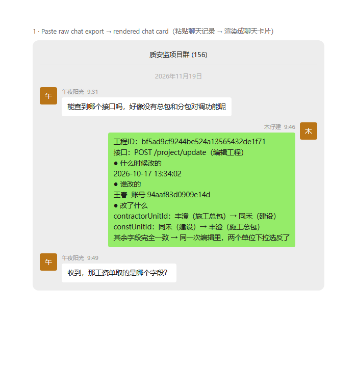
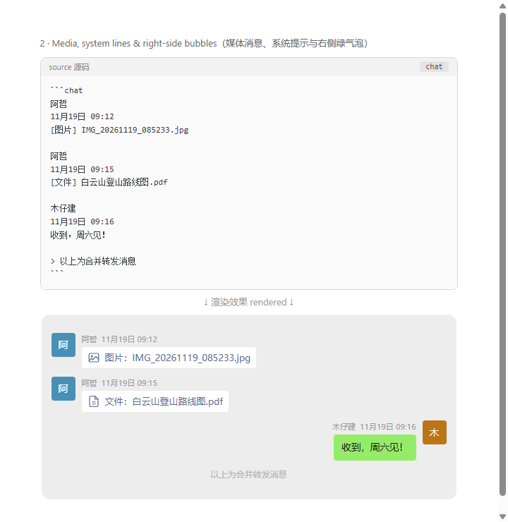

# Chat Log Render

Render chat logs into chat-bubble cards inside your Obsidian notes. Paste a raw chat export (WeChat, QQ, or any `name + time + message` text) into a ` ```chat ` code block and it becomes a clean chat UI in reading view.

在 Obsidian 笔记里把聊天记录渲染成聊天气泡卡片。把微信、QQ 或任意「昵称 + 时间 + 消息」格式的原始聊天记录粘贴进 ` ```chat ` 代码块，阅读视图自动变成干净的聊天界面。

| Paste raw export → rendered card（写代码块 → 得到聊天卡片） | Media, system lines & right-side bubbles（媒体消息、系统提示与右侧绿气泡） |
|---|---|
|  |  |

Each screenshot shows the source code block above and the rendered result below (all data in the screenshots is fictional). 截图为「源码块在上、渲染结果在下」的对照图（图中数据均为虚构）。

## Features 功能

- **Paste and go（粘贴即用）** — no rigid schema. Paste chat text straight from WeChat mobile multi-select, PC exports, or handwritten notes. 无需固定模板，手机多选复制、PC 导出、手写文本都能解析。
- **Three header formats（三种消息头格式）** auto-detected（自动识别）:
  - Name line followed by a time line（昵称行 + 时间行，微信手机端导出）:

    ```
    Alice
    2026/11/19 9:31
    Good morning!
    ```
  - Name and datetime on one line（昵称 + 时间同行，PC 端导出）:

    ```
    Alice 2026/11/19 9:31:02
    Good morning!
    ```
  - Bracket style（方括号格式）:

    ```
    [2026/11/19 9:31:02] Alice: Good morning!
    ```
- **Smart parsing（智能防误判）** — data timestamps inside message bodies (e.g. `2026-10-17 13:34:02` pasted as part of a debug log) are kept as body text, not misread as new messages. 消息正文里的数据时间戳不会被误拆成新消息。
- **Images inside bubbles（气泡内图片）** — standard Markdown ``, relative paths (`../../../附件/img.png`), and Obsidian embeds `![[img.png]]` all render as real images inside the bubble. Path resolution tries vault-relative → note-relative → filename lookup. 气泡内的 Markdown 图片、相对路径、Obsidian 嵌入语法都会显示为真实图片（按 库内路径 → 笔记相对路径 → 文件名 三级解析）。
- **Media lines（媒体消息）** — `[image]`、`[file]`、`[voice]`、`[video]`（`[图片]`、`[文件]`、`[语音]`、`[视频]`）and similar lines render as media cards with icons. 带图标的媒体卡片。
- **System lines（系统提示）** — a line starting with `>` renders as a centered grey system notice (e.g. "Merged forwarded messages" / 「以上为合并转发消息」).
- **Date dividers（日期分隔线）** — inserted automatically when the date changes. 日期变化时自动插入。
- **Avatars（头像）** — deterministic colors from the sender name hash; first character as the avatar letter. 按昵称稳定取色，首字符作头像。
- **Title（标题）** — a `# heading` on the first line becomes the chat window title (group name). 首行 `# 标题` 渲染为顶部群名。

## Usage 用法

````markdown
```chat
# Project Team

Alice
2026/11/19 9:31
Which API was it?

Bob
2026/11/19 9:46
Project ID: bf5ad9cf
API: POST /project/update
- When was it changed
2026-10-17 13:34:02
```
````

Accepted code block languages: `chat`, `chatlog`, `wechat`, `微信`.

支持的代码块语言：`chat`、`chatlog`、`wechat`、`微信`。

## Settings 设置

| Setting 设置 | Description 说明 |
|---------|-------------|
| Right-side name 靠右显示的昵称 | Your own nickname in the chat. Messages from this sender render as green bubbles on the right (like WeChat). Empty = all left. 填你在聊天中的昵称，该昵称消息以绿色气泡靠右显示；留空则全部靠左。 |
| Show avatars 显示头像 | Toggle avatar blocks on/off. 开关头像块。 |

## Manual install 手动安装

1. Download `main.js`, `manifest.json`, `styles.css` from the latest release. 从最新 Release 下载三个文件。
2. Put them in `<vault>/.obsidian/plugins/obsidian-chat-log-render/`. 放入库的 `.obsidian/plugins/obsidian-chat-log-render/` 目录。
3. Enable "Chat Log Render" in Settings → Community plugins. 在 设置 → 第三方插件 里启用。

## How parsing works 解析原理

The parser scans the block twice: first it classifies every line (time header / nick line / body / system / media), then it groups lines into messages. A standalone time line right after body text is treated as data inside the message (common when pasting debug logs); only time lines preceded by a blank line or another message start a new message.

解析器两遍扫描：第一遍给每行分类（时间头 / 昵称行 / 正文 / 系统行 / 媒体行），第二遍按类组装消息。紧跟在正文后面的独立时间行视为消息内的数据（粘贴排障日志时常见）；只有前面是空行或另一条消息的时间行才开启新消息。

## Compatibility 兼容性

- Requires Obsidian 1.0.0 or later. 需要 Obsidian 1.0.0 及以上。
- Works on desktop and mobile (pure JS, no build step). 桌面端、移动端均可用（纯 JS，免构建）。

## License

[MIT](LICENSE)
